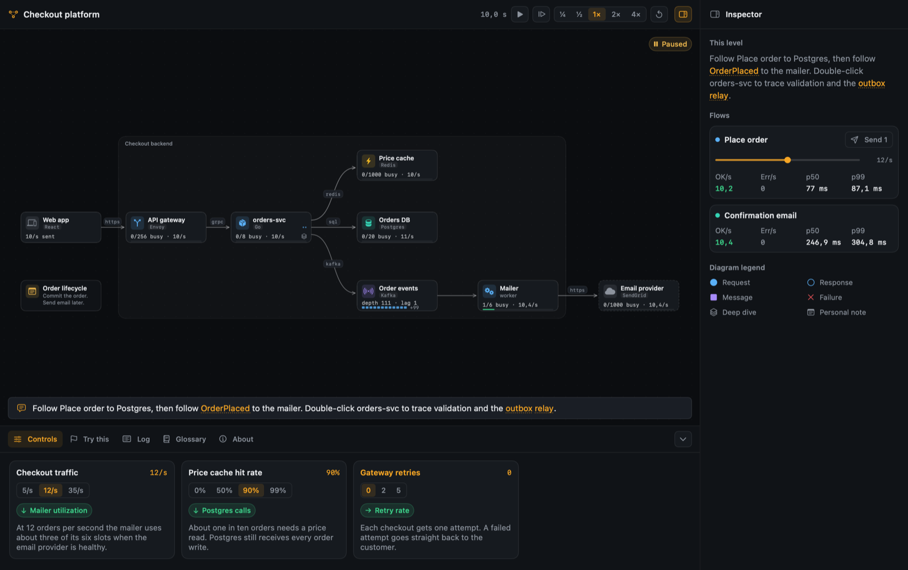
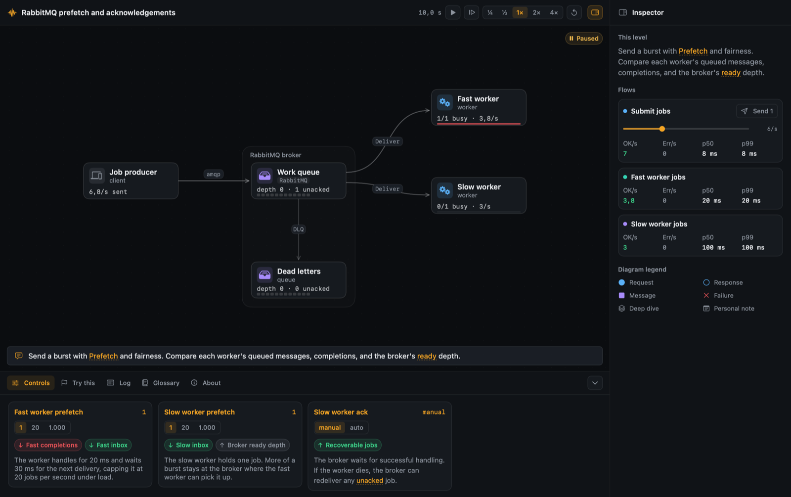
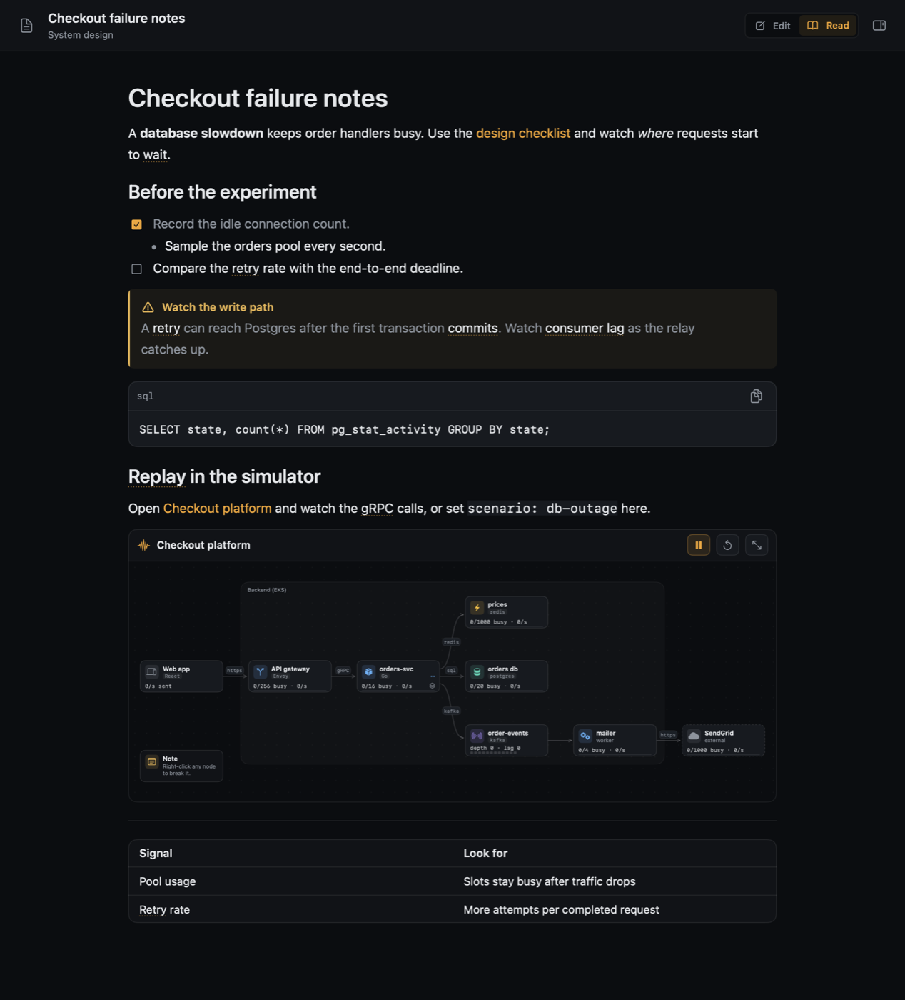

# Strata

A private lab bench for system design on macOS. Strata combines:

- notes in the style of Obsidian;
- live simulators you can poke and break;
- maps of real architectures you can drill into.

Every simulator is a YAML manifest, so any coding agent can build one for the system you're
working on.



## Install

```sh
curl -fsSL https://raw.githubusercontent.com/gabalexander/strata/main/install.sh | sh
```

This needs macOS 26 or later.

- **Apple Silicon** gets the prebuilt app.
- **Intel Macs**, or anyone passing `sh -s -- --source`, build from source. That needs the
  Command Line Tools (`xcode-select --install`).

The installer:

- puts `Strata.app` in `~/Applications`;
- links the `strata` CLI into `~/.local/bin`;
- installs the agent skill for Claude Code (`~/.claude/skills`) and other agents such as Codex
  (`~/.agents/skills`).

Uninstall with `curl -fsSL https://raw.githubusercontent.com/gabalexander/strata/main/install.sh | sh -s -- --uninstall`.
This keeps your data in `~/.strata`.

## What's inside

### Simulators

The engine is discrete-event, so the behaviour is causally true:

- requests travel as tokens and queues fill;
- a slow database blocks the thread pools above it;
- retries multiply load and breakers trip;
- a killed consumer loses nothing with manual ack, and its buffer with auto ack.

Every control explains what changes when you move it. Each lesson has guided "Try this" scenarios.

There are ten built-in lessons:

- RabbitMQ prefetch and acks;
- Kafka consumer groups and lag;
- retries, timeouts and circuit breakers;
- cache stampede;
- thread-pool exhaustion;
- queueing latency near saturation;
- the transactional outbox;
- load balancing;
- an LLM gateway;
- a checkout architecture map.



### Architecture maps

- **Deep dives:** double-click a service to see what's inside, and use the breadcrumbs to come back out.
- **Break things:** right-click any node to kill it, slow it ×10, inject errors or scale it.
  Right-click a link to cut it and watch the timeouts.
- **Your code and notes:** nodes link to your code, and each node can have its own note.

### Notes

- Plain markdown in `~/.strata/vault` with `[[links]]`, backlinks, search and a link graph.
- A ```` ```strata ```` block embeds a live simulator in the page.
- Hover a technical term anywhere for an explanation. About 870 glossary terms ship with the app.



### Ask the map

Ask a map a question in the simulator's Ask tab (⌘L): "what happens if Valkey is down for 30 s?",
"who writes call.status?", "why would a lead stay in 3100?". The answer streams in a few lines, and
every node, operation, mechanism, enum value and table it mentions is a link that selects or opens it.
When the map's repo is on this Mac, Claude can read the code to confirm.

Ask runs your own Claude Code (`claude`) headless with read-only tools, under your Claude Code account:
the question and the map leave your Mac. The app says so the first time on each map, and you can turn
Ask off in the tab or with `ask: { enabled: false }` in `~/.strata/config.yaml` (`ask: { model: haiku }`
picks a model). History stays in `~/.strata/ask`. From a terminal or an agent:
`strata ask checkout "who writes orders.status?"`.

### Private by default

- Strata's windows are excluded from screen sharing and screen recording.
- It stays out of the Dock and ⌘-Tab; ctrl+option+s (or the menu bar icon) shows and hides it.
- Everything lives in `~/.strata`, outside any repo.

## Make your own simulator, or have an agent make one

Ask Claude Code or Codex:

> use the strata skill to map ~/code/my-service

The skill tells the agent how to survey a repo and write the manifest, and how to check it with
`strata validate` and `strata simulate` before it opens it in the app. The app reloads manifests
live while you watch.

When the code moves on, `strata drift <id>` lists what the map no longer matches: moved files, changed
queries, new binaries, topics and status codes. The app marks the stale nodes. Ask the agent to refresh the
map and it fixes exactly those parts.

By hand:

```sh
strata new checkout --kind architecture   # starter manifest in ~/.strata/sims/checkout.yaml
strata validate checkout                  # errors and warnings with line numbers and suggestions
strata simulate checkout --seconds 30     # headless metrics per flow and node
strata open checkout                      # show it in the app
strata ask checkout "what if Postgres is down for 30 s?"   # ask Claude about the map
strata drift checkout                     # what no longer matches the code at its repo:
strata schema                             # the full format reference
```

A taste of the format ([full reference](Resources/Docs/manifest.md)):

```yaml
strata: 1
id: checkout
title: Checkout platform
kind: architecture
nodes:
  - { id: web, kind: client, label: Web app, at: [0, 1] }
  - { id: orders, kind: service, tech: Go, at: [1, 1], latency: 30ms, concurrency: 8 }
  - { id: db, kind: postgres, at: [2, 1] }
edges:
  - { from: web, to: orders, protocol: https }
  - { from: orders, to: db, protocol: sql }
flows:
  - id: place-order
    from: web
    rate: 20/s
    steps:
      - call: orders
        timeout: 1s
        retries: 2
        steps: [ { call: db, label: INSERT order } ]
scenarios:
  - id: db-outage
    label: Postgres goes down
    steps:
      - { at: 2s, do: "kill db", say: "Watch orders-svc's threads fill up." }
      - { at: 7s, do: "restore db" }
```

## Keyboard

| Keys | Action |
|---|---|
| ctrl+option+s | show or hide Strata |
| ⌘K / ⌘O | command palette / jump to a note or sim |
| ⌘N, ⌘⇧F | new note, search notes |
| ⌘[ ⌘] | back, forward |
| ⌘\\, ⌘⌥I, ⌘J | sidebar, inspector, simulator dock |
| Space, `.`, ⌘R, ⌘0 | play/pause, step, reset, fit (in a simulator) |
| ⌥⌘L, ⌥⌘V | tidy a manual layout; run the map top to bottom or left to right (in a simulator) |
| ⌘L | ask the map (in a simulator) |
| ⌘⇧E | edit or read a note |

## Build from source

Swift 6.2+ with the Command Line Tools is enough; Xcode isn't needed.

```sh
make app        # build/Strata.app
make install    # install your local build
make checks     # engine, parser and vault checks
make snapshots  # render the main screens to build/snapshots
```

See [docs/architecture.md](docs/architecture.md) for how the pieces fit, and
[docs/design.md](docs/design.md) for the visual language.

## License

[MIT](LICENSE)
